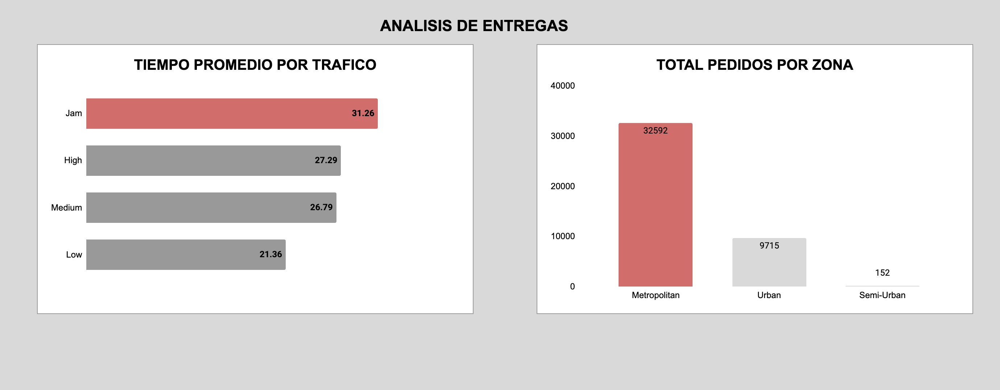

# Análisis de Cuellos de Botella Logísticos (Delivery)

## 1. Objetivo del Proyecto
El objetivo de este proyecto es analizar una base de datos histórica de más de 42.000 entregas de una empresa de delivery para identificar las variables que penalizan los tiempos de entrega. A través de este análisis, se busca proveer *insights* accionables al equipo de operaciones para optimizar la logística y reducir costos.

## 2. Herramientas y Preparación de Datos
* **Herramientas:** Google Sheets (Limpieza y Visualización) y SQLite (Exploración y Análisis).
* **Limpieza de Datos:** 
  * Eliminación de valores nulos (NaN) para evitar sesgos analíticos.
  * Estandarización de cadenas de texto (ej. remoción del sufijo "(min)" en la columna de tiempos).
  * Conversión de tipos de datos a INTEGER y REAL para permitir cálculos matemáticos precisos en SQL.

## 3. Preguntas de Negocio y Hallazgos SQL

**A. ¿Cuál es el impacto del tráfico en los tiempos de entrega?**
Existe una brecha operativa de casi 10 minutos entre realizar una entrega con tráfico atascado (Jam: 31.26 min) frente a un escenario de tráfico bajo (Low: 21.36 min).

**B. ¿Cómo afecta el clima a la operación?**
La visibilidad es un factor crítico. La niebla (Fog) dispara el tiempo promedio a 29.06 minutos, sumando más de 7 minutos de demora en comparación con un día soleado (21.93 min).

**C. ¿Qué impacto tiene la condición del vehículo del repartidor?**
Se descubrió que los vehículos en mal estado (Condición 0) promedian 30.14 minutos por entrega. Sin embargo, no existe una diferencia significativa de tiempo entre un vehículo en estado estándar (Condición 1: 24.47 min) y uno en estado óptimo (Condición 2: 24.58 min). 

**D. ¿Afecta el tipo de comida al tiempo total?**
El tipo de producto (Snack, Buffet, Drinks, Meal) tiene un impacto nulo en la cadena logística, promediando todos entre 26.32 y 26.53 minutos. El cuello de botella operativo no reside en la preparación de alimentos específicos.

## 4. Visualización Ejecutiva
*Nota para el equipo directivo: El siguiente panel destaca los cuellos de botella clave por volumen y tipo de tráfico.*

